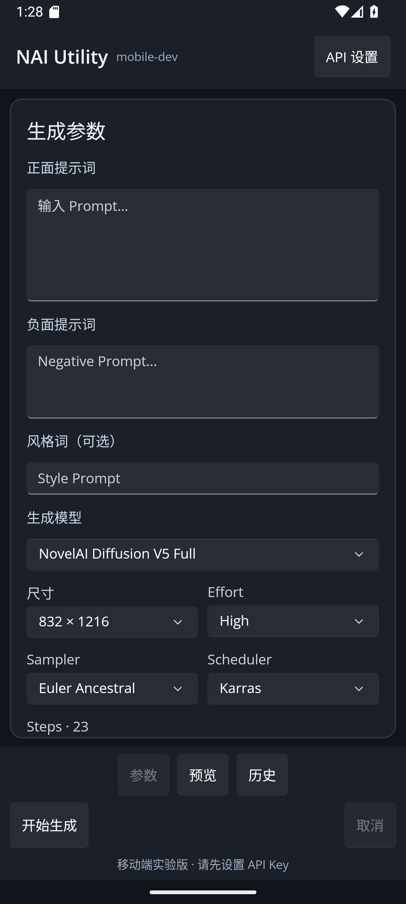

# NAI mobile-dev：真实进度（2026-10-10）

基线：Andy-linux/NAI-Utility-Tool **dev @ cc28495**，独立 `mobile-dev` worktree；原 Windows dev/main 与 NyaProxy/线上服务器均未修改。

## 本轮实际交付

- 官方 Uno Platform 6.7.30 单项目，.NET10 Android/iOS/iPadOS/Skia Desktop UI；独立 `src/NAITool.Mobile/`，原 WinUI 3 继续保持。手机以参数/预览分页，宽屏参数与预览并排；暗色主题。
- `NAITool.Mobile.Core` 使用源码链接复用 dev 的 `NAIParameters`、`ModelCapabilities`、`NovelAiPromptPresets`、`NovelAiAnlasCalculator`、`SeedValue`、`ApiEndpointResolver`、原生 MessagePack/SSE/ZIP 响应解析、`ViewTransform` 和 `UndoManager` 等；无 Windows Win2D/DirectML/DPAPI。
- 移动 HTTP adapter：API Root 归一、官网与 NyaProxy 兼容接口、V5 High/Medium、Prompt/Negative/风格词、单角色、模型/尺寸/Steps/CFG/Seed、非流式 ZIP 或流式最终帧生成结果。预览、取消、应用沙盒历史保存已经写代码；没有自动重试收费请求。
- **离线 mock 8/8 PASS**：模型参数与角色、Medium 固定约束与保留 High 草稿、URL 白名单、ZIP 生图/重复结果拒绝、401、MsgPack final 与缺失 final 拒绝。未发送真实 API Key、未做收费生图。
- **真实编译**：Core Release net9（0 warnings/0 errors）；Uno Skia Desktop Release net10（0 errors，首次构建有两个警告后已修复）；Android Release ARM64 APK（0 warnings/0 errors）。
- **APK** `src/NAITool.Mobile/NAITool.Mobile/bin/Release/net10.0-android/android-arm64/com.andy.naiutility.mobiledev-Signed.apk`：27,674,638 bytes；SHA256 `B75C9079EFE7C13373151B53E09898F0BA56F486D8087CDFABEC492ADE8227A0`；Debug 测试签名（v1/v2/v3 验签通过）、minSdk 21、targetSdk 36、INTERNET 权限。
- 构建机：`F:\nai\.tools\dotnet` SDK 9/10、Uno.Templates、Android workload、Microsoft JDK21、Android Platform36；系统级 .NET/Windows PC 项目未调整。

## 构建/运行命令

在工作树根目录的 PowerShell：

```powershell
$env:DOTNET_ROOT = 'F:\nai\.tools\dotnet'
$env:JAVA_HOME = 'F:\nai\.tools\jdk21-dist\jdk-21.0.12.1+1'
$env:ANDROID_HOME = "$env:LOCALAPPDATA\Android\Sdk"
$env:PATH = "$env:DOTNET_ROOT;$env:JAVA_HOME\bin;$env:PATH"

dotnet run -c Release --project src/NAITool.Mobile/NAITool.Mobile.Core.Tests/NAITool.Mobile.Core.Tests.csproj

dotnet build src/NAITool.Mobile/NAITool.Mobile/NAITool.Mobile.csproj -c Release -f net10.0-android `
  -p:MobileOnlyBuild=true -p:RuntimeIdentifiers=android-arm64 -p:RuntimeIdentifier=android-arm64 `
  -p:AndroidPackageFormat=apk -p:JavaSdkDirectory="$env:JAVA_HOME" -p:AndroidSdkDirectory="$env:ANDROID_HOME"

dotnet build src/NAITool.Mobile/NAITool.Mobile/NAITool.Mobile.csproj -c Release -f net10.0-desktop -p:UseMonoRuntime=false
```

Uno 官方文档说明 `.NET10` Desktop 的 Mono.win-x64 某些运行时版本不发布，所以 Desktop 编译需 `-p:UseMonoRuntime=false`，Android/iOS 仍必须 Mono。

## Android 模拟器实际运行

- 在 Android API 35、x86_64 模拟器安装并启动 x86_64 Release 测试 APK，`adb install` 返回 `Success`；进程持续存活，打开 API 设置正常，未见 AndroidRuntime 崩溃。
- ARM64 APK 在 x86_64 模拟器中出现 Mono JNI 原生 ABI 崩溃；转用 x86_64 包后启动成功。ARM64 手机仍需真机验收。
- 视觉检查发现暗色顶部状态栏图标对比不足、底部手势区域遮盖文字，已采用 Uno.Toolkit `StatusBar.Foreground=Light` 与 `SafeArea.Insets=VisibleBounds` 修复，重新截图验证。
- 实测截图：；模拟器已退出释放资源。

## 尚未完成，不能声称已交付

- iOS/iPadOS 的 Mac+Xcode 编译、签名、iPhone/iPad 真机触控以及 Apple Pencil。
- P1：Win2D 蒙版/重绘 → Skia、撤销性能优化、双指缩放/笔输入、更多角色/位置、相册导出、Vibe/Precise Reference、账户/额度、完整历史与图库。
- P2：本地 ONNX/Tagger/DirectML 替代、后期效果链、Wildcards 和自动化。
- 真实 NovelAI/NyaProxy 的收费请求和流式生产服务全链路未发起；未经真实设备核查的 UI/字体/安全区不应算完成。
- 指定 `gpt-6.1-sol` medium：已尝试在本机 Codex CLI 调用，但当前 ChatGPT 认证通道返回 HTTP 400「该模型不受支持」，实际编写没有使用该模型，必须透明记录。没有因此停工或擅自切换模型声称成功。

后续：Android 模拟器安装及 UI 检查；随后蒙版/重绘和移动触控编辑器。完整的功能优先级、代码复用边界与官方来源见 `MIGRATION_PLAN.md`。
